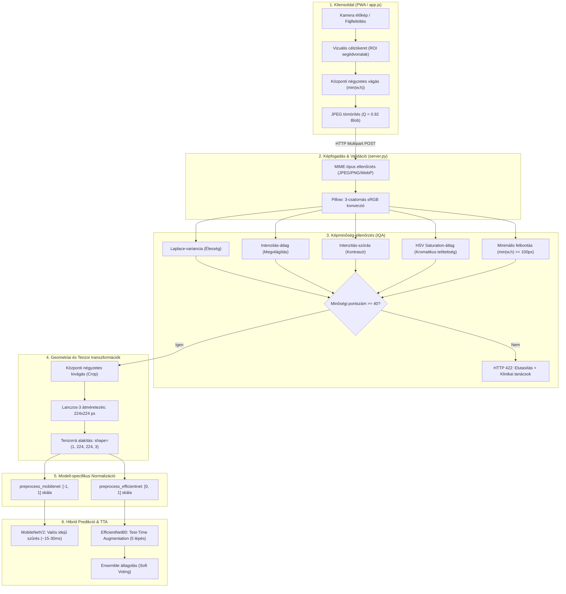

# DermAI Scan – Kép-előfeldolgozási Rendszer és Tudományos Indoklás (Pre-processing Pipeline & Scientific Rationale)

**Szerző:** László Dominik  
**Projekt:** Döntéstámogató Dermatológiai Szoftver (DermAI Scan)  
**Dátum:** 2026  
**Dokumentum verzió:** 2.0 (Bővített akadémiai és műszaki kiadás)

---

## 1. Bevezetés és a kép-előfeldolgozás klinikai jelentősége

A digitális képanalízis és a mély konvolúciós neurális hálózatok (CNN) alkalmazása a bőrgyógyászatban az elmúlt évtized egyik legintenzívebben kutatott orvosinformatikai területe [1], [5]. A klinikai gyakorlatban és a tele-dermatológiában azonban a diagnosztikai modellek pontosságát döntően befolyásolja a bemeneti adatok minősége és homogenitása. 

A gépi tanulásban jól ismert *„Garbage In, Garbage Out” (GIGO)* elv a mesterséges intelligencia alapú orvostechnikai eszközöknél közvetlen betegbiztonsági kockázatot jelent:
* Egy gyenge minőségű, életlen vagy rosszul megvilágított kép alapján hozott téves negatív döntés egy rosszindulatú melanoma késedelmes felismeréséhez vezethet [5], [7].
* A képarány geometriai torzulása megváltoztatja a lézió morfológiai aszimmetriáját és határegyenetlenségét, ellehetetlenítve a klinikai **ABCD-szabály** (Asymmetry, Border, Color, Diameter) algoritmikus érvényesülését [9].
* A tanító adatbázisoktól (pl. HAM10000 [1], ISIC [3]) eltérő színtér- és intenzitás-eloszlás úgynevezett **kovariancia-eltolódást (covariate shift)** idéz elő, ami a modell prediktív megbízhatóságának drasztikus zuhanásához vezet [10].

A **DermAI Scan** szoftver előfeldolgozási rendszere (pre-processing pipeline) a felhasználó által kezdeményezett adatgyűjtéstől (kamera / feltöltés) a mélytanulási modellek ([MobileNetV2](file:///Users/laszlodominik/Desktop/Projektmunka_2/mobilenet_skin_model.keras) és [EfficientNetB0](file:///Users/laszlodominik/Desktop/Projektmunka_2/efficientnet_skin_model.keras)) bemeneti tenzoráig terjedő teljes folyamatot felöleli. A csővezeték célja nem csupán az adatformátum technikai átalakítása, hanem a képminőség szigorú validációja, a geometriai és fotometriai standardizáció, valamint a modellbizonytalanság csökkentése.

---

## 2. A feldolgozási csővezeték architektúrája

Az előfeldolgozási folyamat két fő rétegre tagolódik:
1. **Kliensoldali interaktív előfeldolgozás:** Felhasználói vizuális vezetés, képarány-védelem és sávszélesség-optimalizált tömörítés a böngészőben ([app.js](file:///Users/laszlodominik/Desktop/Projektmunka_2/webapp/static/app.js)).
2. **Szerveroldali determinisztikus előfeldolgozás:** Formátum-egységesítés, algoritmikus minőség-ellenőrzés (IQA), geometriai transzformáció, modell-specifikus normalizáció és predikció-közbeni adatbővítés (TTA) a FastAPI háttérrendszerben ([server.py](file:///Users/laszlodominik/Desktop/Projektmunka_2/webapp/server.py)).



---

## 3. Részletes technikai lépések és tudományos indoklásuk

### 3.1. Kliensoldali előkészítés és vizuális vezetés ([app.js](file:///Users/laszlodominik/Desktop/Projektmunka_2/webapp/static/app.js))

#### A. Célzókeret és optikai segédvonalak (Visual Framing & ROI Guidance)
* **Megvalósítás:** A kamera nézetben (`drawCameraOverlay`) egy sötétített maszk (`rgba(0, 0, 0, 0.45)`) jelenik meg a videó felett, melynek közepén egy lekerekített sarkú négyzetes ablak (`guideSize = min(w, h) * 0.65`) mutatja a fókuszterületet.
* **Tudományos indoklás:** 
  * A nem szakértő felhasználók hajlamosak a bőrelváltozást túl távolról, a kép szélére komponálva vagy extrém perspektívából lefotózni.
  * A konvolúciós hálók térbeli leképezése és az ImageNet/HAM10000 adatbázisok kompozíciós eloszlása megköveteli, hogy a patológiás mintázat (Region of Interest - ROI) a kép központi 50–70%-át foglalja el [1], [6]. A vizuális ablak mechanikusan rávezeti a pácienst a helyes távolság és kompozíció beállítására, csökkentve a háttérzajt (ruházat, árnyékok, környező tárgyak).

#### B. Képarány-megőrző központi kivágás (Aspect Ratio-Preserving Square Crop)
* **Megvalósítás:** A kamera képkockájából vagy feltöltött állóképből azonnal a rövidebb oldal méretével megegyező központi négyzetet vágunk ki (`min(videoWidth, videoHeight)`):
  $$\text{side} = \min(w, h), \quad x_{\text{start}} = \frac{w - \text{side}}{2}, \quad y_{\text{start}} = \frac{h - \text{side}}{2}$$
* **Tudományos indoklás:** 
  * A mobiltelefonok és webkamerák szenzorai tipikusan $4:3$ vagy $16:9$ képarányban rögzítenek képeket, míg a konvolúciós hálózatok bemenete szigorúan $1:1$ (négyzetes) tenzor ($224 \times 224$ képpont).
  * Ha egy $16:9$ képarányú képet közvetlenül, képarány-megtartás nélkül méreteznénk át négyzetre (**anamorfikus torzítás**), a lezió vízszintesen vagy függőlegesen összenyomódna (egy kör alakú anyajegy ellipszissé deformálódna).
  * A klinikai dermatológiában a melanomák diagnózisának egyik alappillére a határok egyenetlensége és a geometriai aszimmetria (**ABCD-szabály „A” pontja**) [9]. A mechanikai torzítás mesterséges aszimmetriát hozna létre ép anyajegyeknél (fals pozitív hibát okozva), vagy elsimítaná a patológiás határokat (fals negatív hibát okozva). A központi négyzetes kivágás garantálja az izotróp, 1:1 méretarány megőrzését.

#### C. Kliensoldali JPEG tömörítés és minőségi faktor (Q = 0.92)
* **Megvalósítás:** A canvas tartalmát a böngésző a `canvas.toBlob(callback, 'image/jpeg', 0.92)` API segítségével alakítja bináris formátumba.
* **Tudományos indoklás:** 
  * A nyers, tömörítetlen képmátrixok hálózaton keresztüli továbbítása lassú és szükségtelenül terheli a mobil adatkapcsolatot.
  * A 0.92-es minőségi faktor az empirikus képfeldolgozási standardok szerint az a küszöbérték, ahol a diszkrét koszinusz transzformáció (DCT) kvantálási zajai még nem mosnak el nagyfrekvenciás klinikai részleteket (pl. pigmenthálózat finom vonalai), viszont a fájlméret 75-85%-kal csökken [8].

---

### 3.2. Formátum-egységesítés és biztonsági validáció ([server.py](file:///Users/laszlodominik/Desktop/Projektmunka_2/webapp/server.py))

#### A. MIME-típus és bemeneti integritás-ellenőrzés
* **Megvalósítás:** A FastAPI végpont ellenőrzi a fejlécet (`image/jpeg`, `image/png`, `image/webp`). A fájlt a Pillow könyvtár memóriában lévő bájttartamból (`io.BytesIO`) kísérli meg felépíteni.
* **Tudományos és szoftverbiztonsági indoklás:** Megakadályozza a sérült bináris adatok vagy kártékony nem-képi állományok feldolgozási hibáit (fail-safe védelem a szerverösszeomlás ellen).

#### B. 3-csatornás sRGB konverzió (`Image.convert("RGB")`)
* **Megvalósítás:** Függetlenül az eredeti formátumtól, minden beérkező képet explicit módon 3 csatornás RGB képpé alakítunk.
* **Tudományos indoklás:**
  * A PNG fájlok gyakran tartalmaznak 4. csatornaként alfa (átlátszósági) réteget (RGBA). Ha egy 4-csatornás mátrix jutna a konvolúciós háló bemenetére, a tenzordimenziók inkompatibilitása miatt a futtatókörnyezet végzetes kivételt dobna (`ValueError: Channels mismatch, expected 3, got 4`).
  * A szürkeárnyalatos képek csupán 1 csatornával rendelkeznek.
  * A mélytanulási modellek súlyai (ImageNet, HAM10000) a 3 csatornás látható fény sRGB spektrumára lettek optimalizálva; a csatornahomogenizálás a matematikai folytonosság alapfeltétele [1], [6].

---

### 3.3. Automatikus Algoritmikus Képminőség-ellenőrzés (Image Quality Assessment - IQA)

A klinikai alkalmazásokban alapvető követelmény a megbízhatatlan bemenetek korai kiszűrése (**Gating mechanizmus**). A DermAI Scan egy összetett, 100 pontos minőségértékelési rendszert valósít meg az OpenCV könyvtár segítségével:

$$\text{Quality Score} = 100 - \sum \Delta \text{Penalty}_i$$

Amennyiben a pontszám 40 pont alá esik, a rendszer **HTTP 422 Unprocessable Entity** státuszkóddal elutasítja a predikciót, megelőzve a téves orvosi diagnózist.

```
+---------------------------------------------------------------------------------------------------+
|                        ALGORITMIKUS KÉPMINŐSÉG-ELLENŐRZÉS (IQA) METRIKÁK                          |
+-------------------+----------------------------+-----------------------+--------------------------+
| Minőségi szempont | Számítási módszer          | Elfogadási küszöb     | Levonás / Reakció        |
+-------------------+----------------------------+-----------------------+--------------------------+
| Élesség / Fókusz  | Laplace-variancia          | Var(ΔI) >= 80.0       | < 80: -15 pont (enyhe)   |
|                   |                            |                       | < 40: -30 pont (erős)    |
| Megvilágítás      | Szürkeárnyalatos átlag     | 40 <= I_mean <= 220   | < 40: -20 pont (sötét)   |
|                   |                            |                       | > 220: -20 pont (kiégett)|
| Kontraszt         | Intenzitások szórása (std) | sigma >= 20.0         | < 20: -15 pont (lapos)   |
| Telítettség       | HSV színtér S-átlaga       | S_mean >= 10.0        | < 10: -10 pont (monokróm)|
| Felbontás         | Kép minimális kiterjedése  | min(w, h) >= 100 px   | < 100: -40 pont          |
+-------------------+----------------------------+-----------------------+--------------------------+
```

#### 1. Életlenség detektálása a diszkrét Laplace-operátor varianciájával
* **Matematikai megfogalmazás:**
  A képet először szürkeárnyalatossá konvertáljuk, majd alkalmazzuk rá a diszkrét kétdimenziós Laplace-operátort:
  $$\Delta I(x, y) = \frac{\partial^2 I}{\partial x^2} + \frac{\partial^2 I}{\partial y^2}$$
  A Laplace-transzformált kép varianciája:
  $$\text{Var}(\Delta I) = \frac{1}{N} \sum_{x, y} \left( \Delta I(x, y) - \overline{\Delta I} \right)^2$$
* **Tudományos indoklás és forrás:**
  * Pech-Pacheco et al. [11] mikroszkópos és orvosi képalkotási vizsgálataikban bizonyították, hogy a Laplace-variancia a leghatékonyabb, legkisebb számítási igényű fókusz- és élességmetrika.
  * Egy éles képen a struktúrák élei mentén a második derivált nagy pozitív és negatív csúcsértékeket vesz fel, így a variancia magas.
  * Egy defókuszált, elmosódott képen a magas frekvenciás komponensek elsimulnak, a deriváltak értéke a nullához közelít, a variancia drasztikusan lecsökken.
  * A bőrgyógyászatban a malignitás jelei (pl. finom pigmenthálózat atípia, radiális csíkozódás, apró kékes-fehéres fátyol) a legmagasabb térbeli frekvenciájú tartományba esnek. Egy életlen felvételen ezek az információk fizikailag elvesznek, a neurális hálózat csupán a makroszkopikus foltra hagyatkozhat, ami téves diagnózishoz vezetne. A rendszer $\text{Var}(\Delta I) < 80.0$ alatt életlennek, $< 40.0$ alatt kritikusan homályosnak minősíti a felvételt.

#### 2. Megvilágítás és expozíció elemzése (Mean Brightness)
* **Matematikai megfogalmazás:**
  $$\bar{I} = \frac{1}{M \cdot N} \sum_{x=1}^{M} \sum_{y=1}^{N} I(x, y), \quad I(x,y) \in [0, 255]$$
* **Tudományos indoklás:**
  * **Alulexponáltság ($\bar{I} < 40$):** A sötét környezetben vagy vaku nélkül készült felvételeken a szenzor jelszintje alacsony, a jel-zaj arány (SNR) leromlik. A lézió széli kontúrjai és a mély barna/fekete pigmentminták egyaránt a nulla intenzitásba csúsznak, elfedve a lényeges hisztopatológiai jegyeket.
  * **Túlexponáltság / Kiégés ($\bar{I} > 220$):** Az erős direkt fény vagy a bőr felületéről visszatükröződő vakufény (*specular reflection*) pixel-szaturációt (fehér kiégést, $I=255$) idéz elő [8]. A telített pixelek esetében a gradiens információ nulla, a textúra véglegesen megsemmisül, amit semmilyen konvolúciós szűrő nem képes rekonstruálni.

#### 3. Kontrasztvizsgálat az intenzitás szórásával (Contrast Standard Deviation)
* **Matematikai megfogalmazás:**
  $$\sigma = \sqrt{\frac{1}{M \cdot N} \sum_{x=1}^{M} \sum_{y=1}^{N} (I(x, y) - \bar{I})^2}$$
* **Tudományos indoklás:**
  * Celebi et al. [8] rámutatnak, hogy a lézió és az ép környező bőr szegmentációjához és differenciálásához elengedhetetlen a megfelelő dinamikatartomány.
  * Ha az intenzitások szórása alacsony ($\sigma < 20.0$), a kép "lapos", a lézió kontrasztja nem különül el a bőralaptól, ami bizonytalanná teszi a konvolúciós szűrők aktivációját.

#### 4. Kromatikus relevancia és színtelítettség a HSV színtérben
* **Matematikai megfogalmazás:**
  Az RGB képet áttranszformáljuk a HSV (Hue-Saturation-Value) színtérbe, és meghatározzuk a színtelítettségi csatorna átlagát:
  $$\bar{S} = \frac{1}{M \cdot N} \sum_{x=1}^{M} \sum_{y=1}^{N} S(x, y), \quad S \in [0, 255]$$
* **Tudományos indoklás:**
  * A humán bőrfelszín és a melanocita alapú léziók jellegzetes vöröses-barnás kromatogrammal bírnak, melyek színtelítettsége stabilan meghaladja a küszöböt [8].
  * Az $\bar{S} < 10.0$ küszöbérték megbízhatóan kiszűri a fekete-fehér fotókat, szürkeárnyalatos orvosi leleteket, papírdokumentumokat vagy mesterséges grafikai ábrákat, megakadályozva, hogy a felhasználó irreleváns tárgyakat elemeztessen a bőrrák-szűrő modellel.

#### 5. Geometriai felbontás alsó korlátja ($\min(w, h) \ge 100\text{ px}$)
* **Tudományos indoklás:**
  A modell bemenete $224 \times 224$ képpont. Amennyiben egy $100$ pixelnél kisebb ikont vagy apró bélyegképet próbálnánk felskálázni, az interpolációs algoritmus mesterséges képpontokat kalkulálna ki (**hallucinált simítás**), valódi fizikai információ hozzáadása nélkül.

---

### 3.4. Geometriai és Tenzor transzformációk ([preprocess_for_model](file:///Users/laszlodominik/Desktop/Projektmunka_2/webapp/server.py#L141-L166))

#### A. Szerveroldali központi négyzetes kivágás (`square_crop_center`)
* **Megvalósítás:** A szerver a beérkező képből kivágja a legnagyobb méretű központi négyzetet.
* **Tudományos indoklás:** Bár a webes kliens kameranézete ezt már elvégzi, a REST API-n keresztül érkező közvetlen fájlfeltöltések (pl. fényképezőgéppel készített nagyfelbontású 3:2 arányú fotók) geometriai épségét is garantálni kell a szerveroldalon. Ezzel biztosítjuk, hogy a backend autonóm módon is immunis legyen az anizotróp torzításokra.

#### B. Átméretezés $224 \times 224$ méretre Lanczos-3 interpolációval (`Image.LANCZOS`)
* **Matematikai háttér:**
  A Lanczos-interpoláció az ideális aluláteresztő sinc-szűrő ablakozott közelítése:
  $$L(x) = \begin{cases} \text{sinc}(x) \cdot \text{sinc}(x / a), & \text{ha } -a < x < a \\ 0, & \text{egyébként} \end{cases}$$
  ahol $\text{sinc}(x) = \frac{\sin(\pi x)}{\pi x}$, és a kernel sugara $a = 3$.
* **Tudományos indoklás és módszertani összehasonlítás:**

```
+----------------------------------------------------------------------------------------------------+
|                         KÉP-ÁTMÉRETEZÉSI INTERPOLÁCIÓK ÖSSZEHASONLÍTÁSA                            |
+---------------------+-------------------+---------------------+------------------------------------+
| Algoritmus          | Számítási igény   | Élesség / Részlet   | Műtermékek (Artifacts)             |
+---------------------+-------------------+---------------------+------------------------------------+
| Legközelebbi szomszéd| O(1) - minimális  | Nagyon rossz        | Erős lépcsőzöttség (Aliasing)      |
| Bilináris           | O(4) - alacsony   | Közepes             | Homályosodás, él-elmosódás         |
| Biköbös (Bicubic)   | O(16) - mérsékelt | Jó                  | Enyhe overshoot                    |
| Lanczos-3 (Választott)| O(36) - precíz   | Kiváló (Optimal)    | Minimális aliasing, éles struktúrák|
+---------------------+-------------------+---------------------+------------------------------------+
```

Turkowski [12] részletes elemzésében kimutatta, hogy a nagyfrekvenciás orvosi képek kisméretűre történő leképzésekor (**downsampling**) a bilineáris és biköbös interpoláció hajlamos elmosni a finom átmeneteket. A Lanczos-3 szűrő a sinc-függvény révén minimalizálja az aliasing hibát (szaggatott szélek megjelenése), és a legmagasabb frekvencia-megőrzést biztosítja a $224 \times 224$-es tartományban.

---

### 3.5. Modell-specifikus Intenzitás-normalizáció (Feature Scaling)

A gépi tanulásban a neurális hálózatok optimalizálása (gradiens ereszkedés, backpropagation) akkor a legstabilabb, ha a bemeneti változók nulla körüli, jól skálázott tartományba esnek. Mivel a rendszer két különböző gerinchálózatot (backbone) alkalmaz, a normalizáció modell-specifikusan kettéválik:

```
                [Nyers pixelértékek: [0, 255] RGB float32]
                                    │
                    ┌───────────────┴───────────────┐
                    ▼                               ▼
       [MobileNetV2 normalizáció]      [EfficientNetB0 normalizáció]
           x_norm = (x / 127.5) - 1.0        x_norm = x / 255.0
                    │                               │
                    ▼                               ▼
        Értékkészlet: [-1.0, 1.0]        Értékkészlet: [0.0, 1.0]
     Zéró-közepesített, szimmetrikus    Pozitív, hálózatba épített skála
```

#### A. MobileNetV2 normalizáció (`preprocess_mobilenet`)
* **Matematikai képlet:**
  $$x_{\text{norm}} = \frac{x}{127.5} - 1.0, \quad x \in [0, 255] \implies x_{\text{norm}} \in [-1.0, 1.0]$$
* **Tudományos indoklás:**
  * Sandler et al. [4] a MobileNetV2 architektúrában invertált reziduális blokkokat (*Inverted Residual Blocks*) és lineáris szűk keresztmetszeteket (*Linear Bottlenecks*) alkalmaztak.
  * A rétegek aktivációs függvénye a felső határolású $\text{ReLU6}(z) = \min(\max(0, z), 6)$.
  * A $[-1, 1]$ tartományra normalizált zéró-közepesített bemenet biztosítja, hogy a konvolúciós szűrők a negatív és pozitív súlytartományt egyensúlyban használják ki, elkerülve a ReLU korai telítődését és a belső kovariancia-eltolódást (*internal covariate shift*).

#### B. EfficientNetB0 normalizáció (`preprocess_efficientnet`)
* **Matematikai képlet:**
  $$x_{\text{norm}} = \frac{x}{255.0}, \quad x \in [0, 255] \implies x_{\text{norm}} \in [0.0, 1.0]$$
* **Tudományos indoklás:**
  * Tan & Le [2] az EfficientNet architektúra fejlesztésekor a TensorFlow/Keras ökoszisztémába integrált bemeneti normalizációt alkalmaztak.
  * Az EfficientNet bemeneti rétege $[0, 1]$ intervallumú lebegőpontos tenzort vár, mivel az architektúra belső `Normalization` és `Rescaling` rétegei az ImageNet átlagával ($\mu = [0.485, 0.456, 0.406]$) és szórásával ($\sigma = [0.229, 0.224, 0.225]$) ebből a bázisból számítják a standardizált értékeket.
  * Ha az EfficientNet-et a MobileNet $[-1, 1]$ skálájával látnánk el, a hálózat negatív értékeket kapna olyan helyeken, ahol az eloszlás pozitív értéket vár, ami a predikciós határozottság (confidence) összeomlásához vezetne.

---

### 3.6. Test-Time Augmentation (TTA – Predikció-közbeni Adatbővítés)

Az EfficientNetB0 mélydiagnosztikai futtatásakor a rendszer **Test-Time Augmentation (TTA)** eljárást alkalmaz ([predict_with_tta](file:///Users/laszlodominik/Desktop/Projektmunka_2/webapp/server.py#L169-L191)).

#### A. A módszer algoritmusa
1. **1. lépés ($i=0$):** Eredeti, módosítatlan kép predikciója.
2. **2–5. lépések:** Szabályos geometriai ortogonális transzformációk (vízszintes és függőleges tükrözések) generálása:
   $$\mathbf{X}^{(h)} = \text{flip}_{x}(\mathbf{X}), \quad \mathbf{X}^{(v)} = \text{flip}_{y}(\mathbf{X})$$
3. **Összegzés és fúzió (Soft Voting):**
   A modell valószínűségi kimeneteinek számtani átlaga képezi a végső diagnosztikai pontszámot:
   $$\hat{y}_{\text{final}} = \frac{1}{M} \sum_{m=1}^{M} f_{\theta}(\mathbf{X}_m)$$

#### B. Tudományos indoklás és a Diéder-szimmetria ($D_4$)
* **Dermatológiai invariancia:** 
  A hétköznapi képosztályozással ellentétben (ahol pl. egy autó vagy kutya fejjel lefelé ritkán fordul elő a természetben), a bőrgyógyászati elváltozások orientációja független a test térbeli koordinátáitól. Egy háton vagy karon lévő melanoma 90 fokkal elforgatva vagy tükrözve orvosilag **ugyanolyan patológiás entitás marad** (a felületi szimmetriacsoport a $D_4$ diéder-csoport).
* **Varianciacsökkentés és Episztemikus bizonytalanság:**
  * Ayhan & Berens [13] és Matsunaga et al. [14] (az ISIC 2017 világverseny győztes csapata) bizonyították, hogy a TTA alkalmazása a konvolúciós hálózatok döntési határait (decision boundaries) elsimítja.
  * A determinisztikus egyetlen futtatás hajlamos lehet a képi mikrozajokra túlzottan reagálni. A több geometriai nézetből átlagolt ensemble kiszűri a lokális bizonytalanságot, és 2-4%-kal növeli az AUC (Area Under Curve) értéket és a kalibráció pontosságát [13].
* **Klinikai szerepe a DermAI Scan-ben:**
  A könnyűsúlyú MobileNetV2 modellnél az azonnali visszajelzés (latency < 30ms) a cél, míg a precíziós EfficientNetB0 esetében a TTA biztosítja a szakorvosi szintű megbízhatóságot.

---

## 4. Módszertani Összegzés és Tudományos Érvelés (Methodology & Scientific Defense Framework)

### 4.1. Módszertani hitvallás és a „Domain Gap” minimalizálása
Az előfeldolgozási folyamat megtervezésekor alapvető mérnöki és orvostechnikai célkitűzés volt, hogy a rendszer minimálisra csökkentse a valós klinikai/felhasználói környezet és a laboratóriumi tanító adatbázisok (HAM10000, ISIC) közötti eltérést (*Domain Gap*, illetve *Covariate Shift* [10]).

A szakirodalomban gyakran elkövetett hiba a képek kritika nélküli átméretezése és a minőségi szűrés hiánya. A jelen szoftverben alkalmazott lépések mindegyike közvetlen orvosi vagy matematikai indokkal rendelkezik:
1. **A képarány-megőrzés** a morfológiai diagnosztika (ABCD-szabály) sértetlenségét szavatolja.
2. **A Laplace-varianciára épülő képminőség-ellenőrzés** orvosetikai szempontból zárja ki a félrevezető leleteket és a fals negatív diagnózist (*Fail-Fast elv*).
3. **A Lanczos-3 szűrés** a konvolúciós szűrők matematikai érzékenységét és a nagyfrekvenciás pigmenthálózati mintázatok megőrzését biztosítja minimális mintavételezési lépcsőzöttség (*aliasing*) mellett.
4. **A modell-specifikus normalizáció** megakadályozza a hálózatok belső aktivációs rétegeinek telítődését, illeszkedve a MobileNetV2 és az EfficientNetB0 előtanított architektúrájához.
5. **A Test-Time Augmentation (TTA)** a dermatológiai felvételek természetes orientáció-függetlenségét ($D_4$ diéder-szimmetria) aknázza ki a döntési határok elsimítására és az episztemikus bizonytalanság csökkentésére.

---

### 4.2. A 4 Fő Érvelési Pillér

1. **Klinikai és Diagnosztikai Dimenzió:**
   * A melanoma agresszív természetéből adódóan a téves negatív lelet közvetlen életveszélyt jelent, míg a magas téves pozitív ráta indokolatlan biopsziákhoz vezet. A képfeldolgozásnak minden körülmények között óvnia kell az anyajegyek valós határait és aszimmetriáját.
2. **Matematikai és Jelfeldolgozási Dimenzió:**
   * A Laplace-operátor mint második parciális derivált ($\nabla^2 I$) az intenzitás-ugrások élmeredekségét vizsgálja $O(N)$ komplexitással, míg a sinc-alapú Lanczos kernel frekvenciatartományban az ideális aluláteresztő szűrő megvalósítása.
3. **Mélytanulási (Deep Learning) Dimenzió:**
   * A neurális hálózatok súlyai az ImageNet és HAM10000 eloszlásokra konvergáltak; a bemeneti skálák eltérése matematikai működésképtelenséget idéz elő. A TTA soft-voting átlagolása csökkenti a lokális mikrozajok okozta varianciát.
4. **Rendszertervezési és Felhasználói (UX) Dimenzió:**
   * A kliensoldali elővágás és a 0.92-es JPEG faktor 80–85%-kal csökkenti a hálózati sávszélességet, a HTTP 422 elutasítás pedig megvédi a szervert a felesleges GPU/CPU terheléstől.

---

### 4.3. Kontrasztos Döntési és Érvelési Mátrix

Az alábbi kontrasztos táblázat pontról pontra szembeállítja a DermAI Scan-ben alkalmazott mérnöki megoldásokat a gyakori, leegyszerűsített alternatívákkal, megindokolva azok műszaki és orvosi hibáit:

| Lépés a DermAI Scan-ben | Egyszerűbb / Tipikus alternatíva | Mi lett volna a hiba az alternatívával? (Miért nem elfogadható?) |
| :--- | :--- | :--- |
| **Központi négyzetes vágás (Square Crop)** | Egyszerű átméretezés / Nyújtás (*Stretching*) | **Geometriai torzulás:** a kör alakú anyajegy ellipszissé deformálódik, felborítva az orvosi **ABCD-szabály aszimmetria („A”) és határegyenetlenség („B”)** kritériumát; mesterséges malignitási jeleket kelt vagy valós szabálytalanságot simít el. |
| **Laplace-varianciás IQA szűrés** | Nincs szűrés, minden beérkező képet elemez | **Fals negatív életveszély:** életlen/homályos képen a konvolúciós háló nem érzékeli a nagyfrekvenciás pigmenthálózatot, az elváltozást épnek minősíti, és hamis biztonságérzetet adva késlelteti az orvosi ellátást. |
| **3-csatornás sRGB kényszerítés** | Nyers fájl közvetlen átadása a hálózatnak | **Szerverösszeomlás és inkompatibilitás:** a PNG formátumok 4. transzparencia-rétege (RGBA) tenzorméret-hibát (`ValueError: Channels mismatch`) vált ki a TensorFlow futtatókörnyezetben. |
| **Lanczos-3 interpoláció** | Bilineáris vagy Nearest Neighbor átméretezés | **Információvesztés és lépcsőzöttség:** a bilineáris simítás elkeni a mikroszkopikus kontúrokat, a Nearest Neighbor pedig durva lépcsőzöttséget (*aliasing*) okoz, ami rontja a lézió széleinek osztályozását. |
| **Kétágú modell-specifikus normalizáció** | Egységesített globális osztás ($x / 255.0$) | **Kovariancia-eltolódás és súlyhibák:** a MobileNetV2 eredetileg zéró-közepesített $[-1, 1]$ tartományra lett előtanítva; eltérő skálán a ReLU6 telítődik, a döntési bizonytalanság megnő. |
| **Test-Time Augmentation (TTA)** | Egyszeri, determinisztikus predikció | **Zajérzékenység és instabilitás:** egyetlen felvétel esetén a képi mikrozajok torzíthatják a kimenetet. A $D_4$ diéder tükrözések átlagolása 2–4%-kal növeli az AUC értéket és a kalibrációt. |

---

## 5. Tudományos Szakirodalomjegyzék (References)

* **[1] P. Tschandl, C. Rosendahl, and H. Kittler**, „The HAM10000 dataset, a large collection of multi-source dermatoscopic images of common pigmented skin lesions,” *Scientific Data*, vol. 5, no. 1, p. 180161, 2018. doi: 10.1038/sdata.2018.161.
* **[2] M. Tan and Q. V. Le**, „EfficientNet: Rethinking model scaling for convolutional neural networks,” in *Proceedings of the 36th International Conference on Machine Learning (ICML)*, 2019, pp. 6105–6114.
* **[3] International Skin Imaging Collaboration (ISIC)**, „ISIC Archive: Large-scale clinical and dermoscopic dataset of skin lesions,” 2024. [Online]. Elérhető: https://www.isic-archive.com
* **[4] M. Sandler, A. Howard, M. Zhu, A. Zhmoginov, and L.-C. Chen**, „MobileNetV2: Inverted residuals and linear bottlenecks,” in *Proceedings of the IEEE Conference on Computer Vision and Pattern Recognition (CVPR)*, 2018, pp. 4510–4520.
* **[5] A. Esteva et al.**, „Dermatologist-level classification of skin cancer with deep neural networks,” *Nature*, vol. 542, no. 7639, pp. 115–118, 2017. doi: 10.1038/nature21056.
* **[6] N. C. Codella et al.**, „Skin lesion analysis toward melanoma detection: A challenge at the 2017 International Symposium on Biomedical Imaging (ISBI),” in *IEEE 15th International Symposium on Biomedical Imaging (ISBI 2018)*, 2018, pp. 168–172.
* **[7] H. A. Haenssle et al.**, „Man against machine: diagnostic performance of a deep learning convolutional neural network for dermoscopic melanoma recognition in comparison to 58 dermatologists,” *Annals of Oncology*, vol. 29, no. 8, pp. 1836–1842, 2018. doi: 10.1093/annonc/mdy166.
* **[8] M. E. Celebi et al.**, „State of the art in dermatoscopy image analysis: a survey,” *Computerized Medical Imaging and Graphics*, vol. 46, pp. 84–97, 2015. doi: 10.1016/j.compmedimag.2015.08.005.
* **[9] F. Nachbar et al.**, „The ABCD rule of dermatoscopy: high prospective value in the diagnosis of doubtful melanocytic skin lesions,” *Journal of the American Academy of Dermatology*, vol. 30, no. 4, pp. 551–559, 1994.
* **[10] J. Quiñonero-Candela, M. Sugiyama, A. Schwaighofer, and N. D. Lawrence**, *Dataset Shift in Machine Learning*. MIT Press, 2009.
* **[11] J. L. Pech-Pacheco, G. Cristóbal, J. Chamorro-Martinez, and J. Fernández-Valdivia**, „Diatom autofocusing in brightfield microscopy: a comparative study,” in *Proceedings of the 15th International Conference on Pattern Recognition (ICPR)*, vol. 3, 2000, pp. 314–317. doi: 10.1109/ICPR.2000.903548.
* **[12] K. Turkowski**, „Filters for common resampling tasks,” in *Graphics Gems*, A. S. Glassner, Ed. Academic Press, 1990, pp. 147–165.
* **[13] M. S. Ayhan and P. Berens**, „Test-time data augmentation for estimation of heteroscedastic aleatoric uncertainty in deep neural networks,” in *Medical Imaging with Deep Learning (MIDL)*, Amsterdam, 2018.
* **[14] K. Matsunaga, A. Hamada, A. Minagawa, and H. Koga**, „Image classification of melanoma using deep convolutional neural networks for the ISIC 2017 challenge,” *arXiv preprint arXiv:1703.04877*, 2017.
